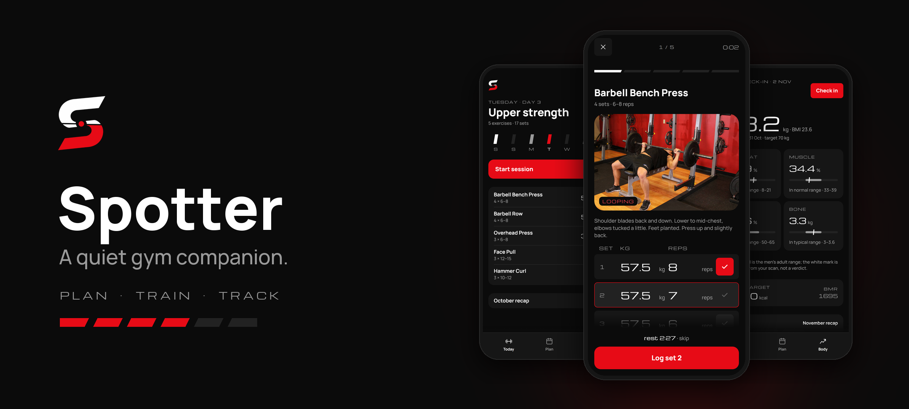
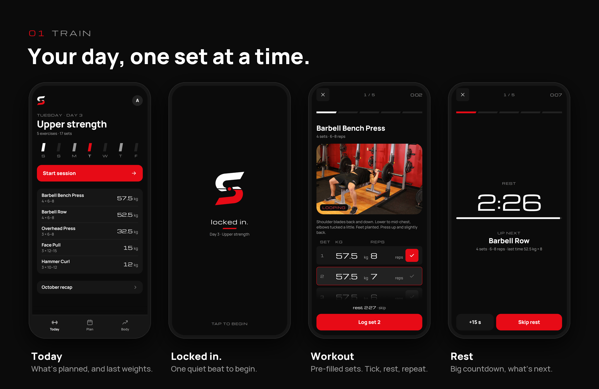
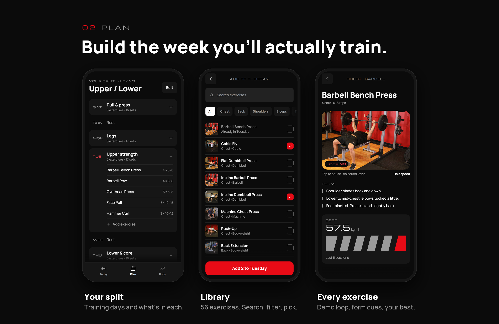
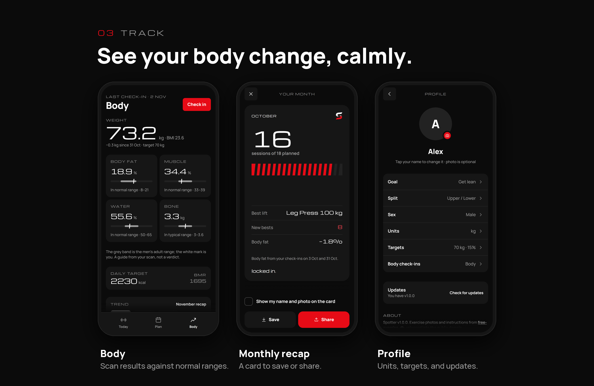
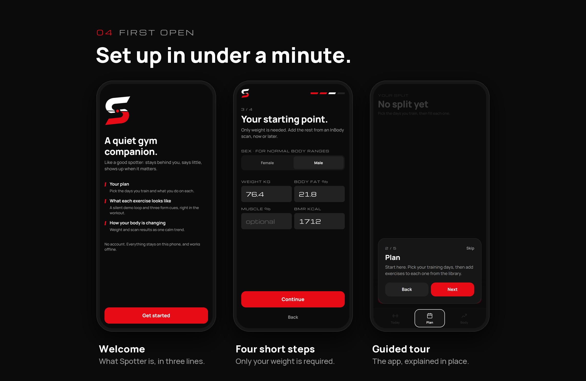

<p align="center">
  
</p>

<p align="center">
  <a href="https://github.com/yeagx/spotter/releases/latest"></a>
  
  
  
  
</p>

<p align="center"><b>Your plan, what each exercise looks like, and how your body is changing.</b></p>

Like a good spotter, the app stays behind you, says little, and shows up when it matters. It isn't a calorie tracker, an AI coach or a social feed. It holds your training split, shows you how each movement is done, logs every set with last week's numbers already filled in, and turns your scale or body scans into one calm trend.

No account, no server, no ads. Everything lives on your phone and works in a basement gym with no signal.

<p align="center">
  <a href="https://github.com/yeagx/spotter/releases/latest"><b>Download for Android (APK) →</b></a>
  &nbsp;·&nbsp;
  <a href="https://spotter-eg.vercel.app/#ios"><b>iPhone (IPA) →</b></a>
</p>

---









---

## What it does

**Plan**
- A named split (Upper / Lower, Full Body, whatever you run) pinned to the days you train.
- Or start from a ready-made one: Full Body (3 days), Upper / Lower (4) or Push / Pull / Legs (6), then change anything.
- Each day holds exercises with sets, a target and rest time: a rep range like `8–12`, seconds for a plank, minutes for the treadmill.
- Reorder a day's exercises any time; workouts follow that order.
- 134 curated exercises to pick from, with search, muscle filters and multi-select.
- Something still missing? Make a custom exercise and give it your own photo, GIF or short clip as its demo.
- Every exercise says exactly what it works ("Upper chest · also Front delts, Triceps"), and search finds muscles too.
- Plan days are pinned to weekdays, but life isn't: a day that slipped by stays open until the week ends. On a rest day it becomes your session; on a training day it waits quietly under today's. Any day can also be started from Plan.

**Train**
- Today opens on what's planned, with the weight you lifted last time.
- A short "locked in." moment when a session starts, then one exercise at a time.
- Sets are pre-filled from your last session. Tick to log, with a soft haptic tap.
- Each exercise logs what makes sense for it: kg × reps, reps only, time, or time and distance for cardio.
- A rest timer between sets, and a full-screen countdown between exercises (+15 s or skip). Both lengths can be set in Profile, or follow each exercise's rest from the plan.
- When rest ends with the phone locked or in a pocket, a short sound and two buzzes tell you (or just the buzz, or nothing).
- The next set sits on the lock screen while you train, with when rest ends. Log set ticks it without unlocking. On iPhone it's a Live Activity (lock screen and Dynamic Island) with a live rest countdown.
- Any set can be removed from today's session, ticked or not; the plan stays as it is.
- Machine taken? Do another exercise from today's session first, or swap in a different one, for this session only.
- On barbell lifts, the plates for each side are worked out for the set you're on. Tap to change the bar.
- A note per exercise ("seat 4, narrow grip") that shows up every time you train it.
- New bests are called out as they happen. Sessions survive the app being closed and can be resumed.
- Leave a session without ending it: Back takes you anywhere in the app, and a Resume bar on every screen brings you back to the same set, with the rest timer still running.
- Music controls in the workout: play, pause, previous and next for whatever's playing (Spotify, YouTube, any player), sent like a headset's buttons. No special access needed. On iPhone, for Apple Music: iOS lets no app control another app's music.
- Focus mode: Do Not Disturb while a session runs, off again when you finish, felt as a click on and a click off. Alarms and the rest timer still come through. On iPhone, where apps can't switch Focus, Spotter runs two shortcuts you add once (Profile shows how).

**See how it's done**
- Every library exercise has a silent demo loop, half speed, and three plain form cues.
- Your best lift, a trend line and your last sessions, set by set, sit under the demo.

**Track**
- Check-ins take weight, and anything else your scale or InBody-style scan gives: BMI, body fat, muscle, water, bone, BMR.
- Each stat is shown against the normal range for your sex, in words ("In normal range · 8–21") as well as on a bar.
- A trend line for weight, body fat and muscle.
- Progress photos (front, side, back) with any check-in, taken in the app or picked from the gallery. They stay inside Spotter, never in your gallery. Compare any two dates side by side, with the change in weight and body fat.
- A check-in can be filled from Health Connect (Android) or Apple Health (iPhone), where smart scales put their readings. Read-only, and only when you ask.
- A daily calorie target estimated from your BMR, goal and training days, or set your own.

**Share it**
- Every finished session has a card: the minutes you trained, each exercise's top set, new bests in red.
- Any day trained this week has its card a tap away on Today's week strip.
- The monthly recap: sessions done against planned, best lift, new bests, and body-fat change when there are two check-ins to compare.
- Both are fixed 4:5 images (1080 × 1350) with the card inset on dark, so chat apps and feeds show them whole.
- Save either to your gallery or share it, with or without your name and photo. The recap can show the month's progress photos too, only if you turn it on.

**Your data**
- Everything lives in SQLite on your phone. No account, nothing sent anywhere.
- Moving phones: Profile → Back up puts it all (plan, sessions, check-ins, progress photos, your own exercises and their clips) in one `.spotter` file. Restore it from Profile, or straight from the first screen on the new phone.

**On your home screen**
- **Today**: the day's exercises with last weights, filling the widget and fading out at the bottom when the day is longer, the week as slanted bars, and Start.
- **Month**: sessions done against planned, best lift, new bests, body-fat change.
- **Best lift**: one lift you pick, its best set and its last six sessions.
- **Body**: your last check-in against your target. **Start**: one tap into today's session.
- **Me**: your photo in a ring that fills with this month's sessions.
- Widgets refresh as you train and fill the space they're given: rows drop when short, type steps up when tall. The widget picker shows a real preview of each.
- Tap a widget and Spotter opens out of it, with the launcher's own animation (Android 12+ launchers that support it, and every iPhone).
- On iPhone the same seven are WidgetKit widgets, in small, medium and large, with Start on the lock screen too. Best lift's lift is picked in Edit Widget (iOS 17+).
- No widget scrolls, on purpose: some launchers keep every swipe for themselves, so a scrolling widget would work on one phone and fight the app drawer on another.

**Stays current**
- Every few hours Spotter quietly asks GitHub for the latest release. When there's a new one, you get one notification, a small dot appears on your picture, and Profile → Updates links straight to the new APK (on iPhone, to the website's install steps; with Spotter's source added, AltStore or SideStore updates it in place). *Check for updates* is there too, any time.
- After an update with something new, a short *What's new* shows once. Fixes-only updates stay silent.

## Install

**Android** (8.0 or later)

1. On your phone, open the [latest release](https://github.com/yeagx/spotter/releases/latest) and download `Spotter-vX.Y.Z.apk`.
2. Open the file. If Android asks, allow installs from your browser.
3. Spotter opens on a short welcome and four quick questions, then a guided tour of the three tabs.

Updating installs over your current version and keeps everything. Don't uninstall first: that deletes your data.

**iPhone** (iOS 16.4 or later)

Spotter isn't on the App Store yet. Each release has an unsigned `Spotter-vX.Y.Z.ipa` that you sign with your own Apple ID:

1. Download the IPA from the [latest release](https://github.com/yeagx/spotter/releases/latest) or the [website](https://spotter-eg.vercel.app/#ios).
2. Open it in [AltStore](https://altstore.io), [SideStore](https://sidestore.io) or [Sideloadly](https://sideloadly.io).
3. Follow its steps to sign it with your Apple ID.

With a free Apple ID the app needs refreshing every 7 days; AltStore and SideStore can do it automatically. For updates, add Spotter's source once (`https://spotter-eg.vercel.app/altstore.json`, or the links on the website): AltStore or SideStore then offers each new version and updates in place, keeping your data.

Everything works on both platforms; where iOS draws a line (music controls, Focus mode, installing updates), Spotter does the closest thing iOS allows. [PLATFORM-PARITY.md](PLATFORM-PARITY.md) has the details.

## Design

Spotter is dark, quiet and deliberate. A few rules shape every screen:

| | |
|---|---|
| **One red** | `#E70B16` appears only where it matters: the primary action, the active set, a done tick, a new best. |
| **Numbers are the hero** | Weights, reps and body stats are set large in Michroma, a wide display face. Everything else is Manrope. |
| **The slant** | The logo's ~26° cut is the only decoration: progress strips, week bars, the recap ticks. Each shape is drawn as a polygon inside its own box. |
| **Say little** | Short, lowercase-friendly lines: "locked in.", "good session.", "new best." No hype, no streak guilt, no emoji. |
| **Slow and weighty** | Motion uses one slow ease-out, staggered entrances, nothing bouncy, and it all switches off with the system's reduce-motion setting. |
| **Fits every phone** | Flex layouts from 360 px phones to tablets, safe areas respected, type that grows with the system font size. |

The full brand book, tokens and approved mockups live in [`design/`](design/).

## Built with

| | |
|---|---|
| App | [Expo](https://expo.dev) SDK 58 · React Native 0.88 · TypeScript · [Expo Router](https://docs.expo.dev/router/introduction/) |
| Data | `expo-sqlite`, on device. Versioned migrations, stable string ids and timestamps on every row, ready for sync later |
| Motion | `react-native-reanimated` · `react-native-svg` for the slanted shapes · `expo-haptics` |
| Keyboard | `react-native-keyboard-controller`, so pinned buttons ride the keyboard frame by frame |
| Media | Demo player that's source-agnostic: photo frames today, filmed `expo-video` loops later with no UI change |
| Sharing | `react-native-view-shot` · `expo-sharing` · `expo-media-library` · `expo-clipboard` |
| Health | [`react-native-health-connect`](https://github.com/matinzd/react-native-health-connect) on Android, [`@kingstinct/react-native-healthkit`](https://github.com/kingstinct/react-native-healthkit) on iPhone, read-only, for filling a check-in from a scale |
| Alerts | `expo-notifications` (alarm-clock delivery, so a rest alert lands on time with the screen off) · `expo-audio` |
| Widgets | Android: [`react-native-android-widget`](https://github.com/sAleksovski/react-native-android-widget), patched to open the app straight from a tap so launchers can animate it. iPhone: [`expo-widgets`](https://docs.expo.dev/versions/latest/sdk/widgets/) (WidgetKit, SwiftUI from TSX) for the widgets and the workout's Live Activity, patched to find the App Group a sideloader grants. Both are fed the same models from SQLite. Patches live in `patches/`, applied by `patch-package` |
| Native | `modules/spotter-media`, a local Expo module: on Android, media-button presses for music controls and Do Not Disturb for Focus mode; on iPhone, Apple Music controls. No special access |
| Backup | `expo-file-system` file handles stream a single archive (JSON + raw photos and clips), so large clips never sit in memory |
| Builds | [EAS Build](https://docs.expo.dev/build/introduction/) → APK, and a GitHub Actions macOS runner → unsigned IPA, both attached to GitHub Releases |

## Run it locally

You need Node 22.13 or newer and the [Expo Go](https://expo.dev/go) app on your phone.

```bash
git clone https://github.com/yeagx/spotter.git
cd spotter
npm install
npx expo start
```

Scan the QR code with Expo Go. Everything runs there except the home screen widgets, music controls, Focus mode and the Health Connect import, which need a build that includes their native modules (the release APK, or a development build with `expo-dev-client`). Other useful commands:

```bash
npx expo start --web   # browser preview (SQLite runs on WebAssembly there)
npm run typecheck      # TypeScript, no emit
npx expo-doctor        # dependency and config checks
```

## Project layout

```text
src/
  app/            Screens. Every file is a route (Expo Router).
    (tabs)/       Today, Plan, Body
    workout/      Workout mode for one session
    ...           Onboarding, Edit split, Edit day, Library, Check-in, Recap, Profile
  components/     Shared UI: buttons, dialogs, the demo player, slanted strips, the tour
  config/         Things you edit by hand: the support link, What's new notes
  db/             SQLite schema and migrations, the exercise library, queries
  lib/            Formatting, units, body ranges, calories, motion, update check
  state/          The shared profile and units
  widgets/        Home screen widgets: their data, Android's layouts, and ios/ (the iPhone
                  widgets and the workout's Live Activity)
  theme.ts        Every colour, size and type style, from design/tokens.json
modules/          spotter-media: the local native module (music controls, Do Not Disturb)
patches/          patch-package fixes to dependencies, applied on every install
.github/          The workflow that builds the iPhone IPA
assets/           Icons, the logo and the 134 exercises' demo frames
design/           Brand book, tokens, mockups, logo
scripts/          Exercise import and brand-asset generation
```

## Releasing

Versions are `vMAJOR.MINOR.PATCH`, and the tag must match `version` in `app.json`.

```bash
# 1. Bump "version" and "android.versionCode" (+1) in app.json. If the release brings
#    anything new, add its notes to src/config/whatsNew.ts. Commit, tag and push.
# 2. Build the APK in the cloud:
npx eas-cli@latest build -p android --profile preview
# 3. Publish it; installed copies will offer the update in Profile:
gh release create vX.Y.Z Spotter-vX.Y.Z.apk --title "Spotter vX.Y.Z" --notes "..."
```

The tag also starts the **iOS IPA** workflow (`.github/workflows/ios-ipa.yml`): it builds an unsigned `Spotter-vX.Y.Z.ipa` on a macOS runner, writes each target's entitlements into it (so AltStore, SideStore and Sideloadly grant the App Group and HealthKit), and attaches it to the same release, waiting for the release if the tag came first. Run by hand from the Actions tab, it's a test build: the IPA is kept as the run's artifact and no release changes (tick *attach* to attach it).

Every feature ships on Android and iPhone together; [PLATFORM-PARITY.md](PLATFORM-PARITY.md) is updated in the same commit.

## Roadmap

- Filmed, silent demo clips replacing the photo frames, one exercise at a time.
- The Play Store and App Store (iPhone is an IPA you sign yourself for now).
- Friends, with a leaderboard ranked by **% improvement**, not raw weight.

## Credits

- Exercise photos and instructions: [free-exercise-db](https://github.com/yuhonas/free-exercise-db), released into the public domain under the Unlicense.
- Typefaces: [Michroma](https://fonts.google.com/specimen/Michroma) and [Manrope](https://fonts.google.com/specimen/Manrope), under the SIL Open Font License.

<p align="center"><sub>locked in.</sub></p>
