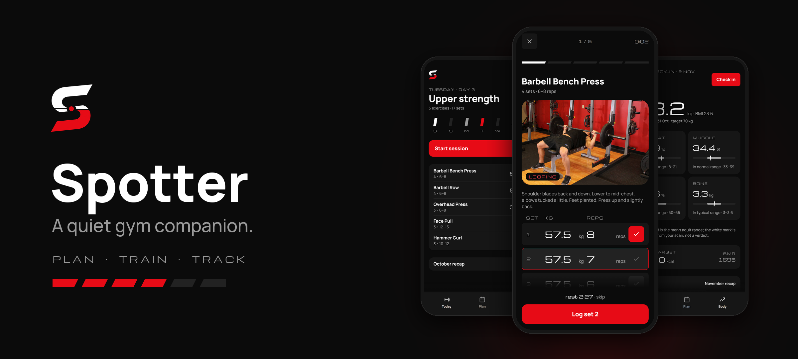
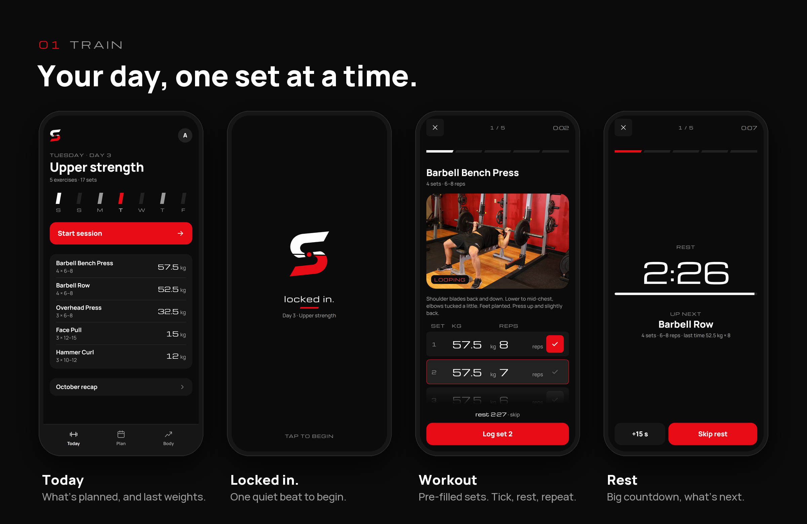
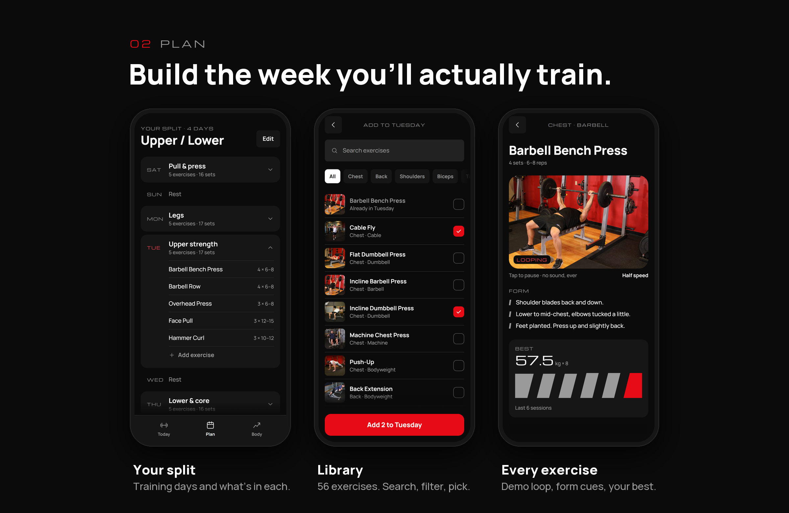
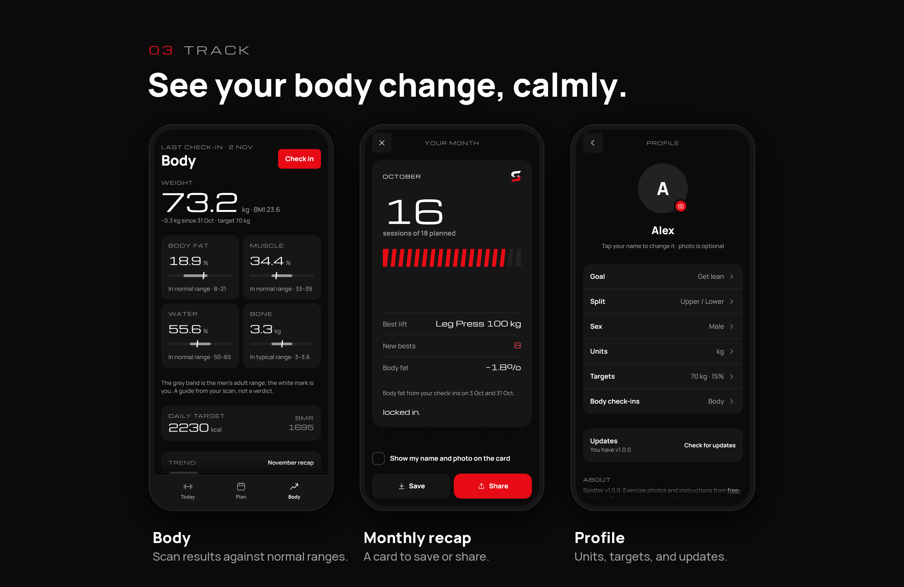
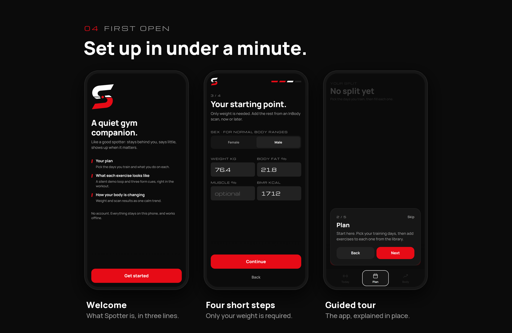

<p align="center">
  
</p>

<p align="center">
  <a href="https://github.com/yeagx/spotter/releases/latest"></a>
  
  
  
</p>

<p align="center"><b>Your plan, what each exercise looks like, and how your body is changing.</b></p>

Like a good spotter, the app stays behind you, says little, and shows up when it matters. It isn't a calorie tracker, an AI coach or a social feed. It holds your training split, shows you how each movement is done, logs every set with last week's numbers already filled in, and turns your scale or body scans into one calm trend.

No account, no server, no ads. Everything lives on your phone and works in a basement gym with no signal.

<p align="center">
  <a href="https://github.com/yeagx/spotter/releases/latest"><b>Download the latest APK →</b></a>
</p>

---









---

## What it does

**Plan**
- A named split (Upper / Lower, Full Body, whatever you run) pinned to the days you train.
- Each day holds exercises with sets, a rep range like `8–12`, and rest time.
- 56 curated exercises to pick from, with search, muscle filters and multi-select. Custom exercises when something's missing.

**Train**
- Today opens on what's planned, with the weight you lifted last time.
- A short "locked in." moment when a session starts, then one exercise at a time.
- Sets are pre-filled from your last session. Tick to log, with a soft haptic tap.
- A rest timer between sets, and a full-screen countdown between exercises (+15 s or skip).
- New bests are called out as they happen. Sessions survive the app being closed and can be resumed.

**See how it's done**
- Every library exercise has a silent demo loop, half speed, and three plain form cues.
- Your best lift and last six sessions sit under the demo.

**Track**
- Check-ins take weight, and anything else your scale or InBody-style scan gives: BMI, body fat, muscle, water, bone, BMR.
- Each stat is shown against the normal range for your sex, in words ("In normal range · 8–21") as well as on a bar.
- A trend line for weight, body fat and muscle.
- A daily calorie target estimated from your BMR, goal and training days, or set your own.

**Monthly recap**
- Sessions done against planned, best lift, new bests, and body-fat change when there are two check-ins to compare.
- Save it to your gallery or share it, with or without your name and photo.

**On your home screen** (Android)
- **Today**: the day's first exercises with last weights, the week as slanted bars, and Start.
- **Month**: sessions done against planned, best lift, new bests, body-fat change.
- **Best lift**: one lift you pick, its best set and its last six sessions.
- **Body**: your last check-in against your target. **Start**: one tap into today's session.
- **Me**: your photo in a ring that fills with this month's sessions.
- Widgets refresh as you train, and drop rows rather than squeeze when resized.

**Stays current**
- Once a day Spotter quietly asks GitHub for the latest release. When there's a new one, a small dot appears on your picture, and Profile → Updates links straight to the new APK. *Check for updates* is there too, any time.
- After an update with something new, a short *What's new* shows once. Fixes-only updates stay silent.

## Install

1. On your Android phone, open the [latest release](https://github.com/yeagx/spotter/releases/latest) and download `Spotter-vX.Y.Z.apk`.
2. Open the file. If Android asks, allow installs from your browser.
3. Spotter opens on a short welcome and four quick questions, then a guided tour of the three tabs.

Requires Android 7.0 or later. iOS and the app stores will come later.

## Design

Spotter is dark, quiet and deliberate. A few rules shape every screen:

| | |
|---|---|
| **One red** | `#E70B16` appears only where it matters: the primary action, the active set, a done tick, a new best. |
| **Numbers are the hero** | Weights, reps and body stats are set large in Michroma, a wide display face. Everything else is Manrope. |
| **The slant** | The logo's ~26° cut is the only decoration: progress strips, week bars, the recap ticks. Each shape is drawn as a polygon inside its own box. |
| **Say little** | Short, lowercase-friendly lines: "locked in.", "good session.", "new best." No hype, no streak guilt, no emoji. |
| **Slow and weighty** | Motion uses one slow ease-out, staggered entrances, nothing bouncy, and it all switches off with the system's reduce-motion setting. |
| **Fits every phone** | Flex layouts from 360 px phones to tablets, safe areas respected, type that grows with the system font size. |

The full brand book, tokens and approved mockups live in [`design/`](design/).

## Built with

| | |
|---|---|
| App | [Expo](https://expo.dev) SDK 58 · React Native 0.88 · TypeScript · [Expo Router](https://docs.expo.dev/router/introduction/) |
| Data | `expo-sqlite`, on device. Versioned migrations, stable string ids and timestamps on every row, ready for sync later |
| Motion | `react-native-reanimated` · `react-native-svg` for the slanted shapes · `expo-haptics` |
| Keyboard | `react-native-keyboard-controller`, so pinned buttons ride the keyboard frame by frame |
| Media | Demo player that's source-agnostic: photo frames today, filmed `expo-video` loops later with no UI change |
| Sharing | `react-native-view-shot` · `expo-sharing` · `expo-media-library` · `expo-clipboard` |
| Widgets | [`react-native-android-widget`](https://github.com/sAleksovski/react-native-android-widget), drawn from the same SQLite data as the screens |
| Builds | [EAS Build](https://docs.expo.dev/build/introduction/) → APK attached to GitHub Releases |

## Run it locally

You need Node 22.13 or newer and the [Expo Go](https://expo.dev/go) app on your phone.

```bash
git clone https://github.com/yeagx/spotter.git
cd spotter
npm install
npx expo start
```

Scan the QR code with Expo Go. Everything runs there except the home screen widgets, which need a build that includes their native module (`eas build --profile development`, or the release APK). Other useful commands:

```bash
npx expo start --web   # browser preview (SQLite runs on WebAssembly there)
npm run typecheck      # TypeScript, no emit
npx expo-doctor        # dependency and config checks
```

## Project layout

```text
src/
  app/            Screens. Every file is a route (Expo Router).
    (tabs)/       Today, Plan, Body
    workout/      Workout mode for one session
    ...           Onboarding, Edit split, Edit day, Library, Check-in, Recap, Profile
  components/     Shared UI: buttons, dialogs, the demo player, slanted strips, the tour
  config/         Things you edit by hand: the support link, What's new notes
  db/             SQLite schema and migrations, the exercise library, queries
  lib/            Formatting, units, body ranges, calories, motion, update check
  state/          The shared profile and units
  widgets/        Android home screen widgets, their data and the Best lift picker
  theme.ts        Every colour, size and type style, from design/tokens.json
assets/           Icons, the logo and the 56 exercises' demo frames
design/           Brand book, tokens, mockups, logo
scripts/          Exercise import and brand-asset generation
```

## Releasing

Versions are `vMAJOR.MINOR.PATCH`, and the tag must match `version` in `app.json`.

```bash
# 1. Bump "version" and "android.versionCode" (+1) in app.json. If the release brings
#    anything new, add its notes to src/config/whatsNew.ts. Commit, tag and push.
# 2. Build the APK in the cloud:
npx eas-cli@latest build -p android --profile preview
# 3. Publish it; installed copies will offer the update in Profile:
gh release create vX.Y.Z Spotter-vX.Y.Z.apk --title "Spotter vX.Y.Z" --notes "..."
```

## Roadmap

- Filmed, silent demo clips replacing the photo frames, one exercise at a time.
- iOS, then the Play Store and App Store.
- Friends, with a leaderboard ranked by **% improvement**, not raw weight.

## Credits

- Exercise photos and instructions: [free-exercise-db](https://github.com/yuhonas/free-exercise-db), released into the public domain under the Unlicense.
- Typefaces: [Michroma](https://fonts.google.com/specimen/Michroma) and [Manrope](https://fonts.google.com/specimen/Manrope), under the SIL Open Font License.

<p align="center"><sub>locked in.</sub></p>
